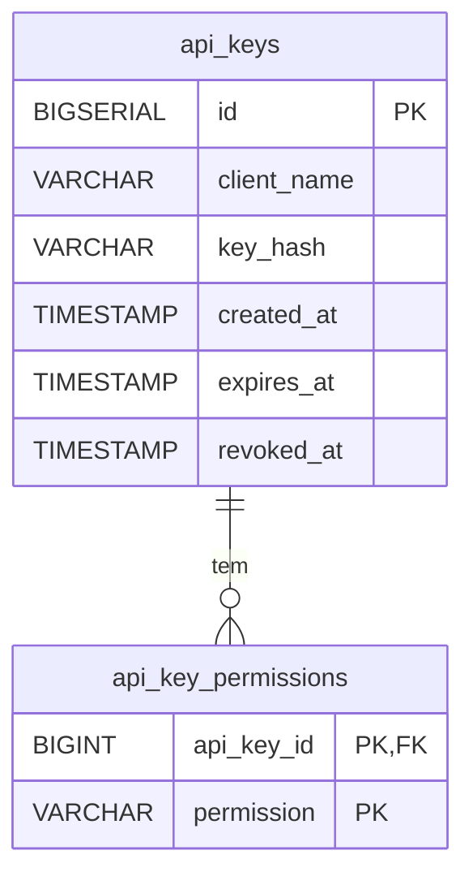

# Data model: key-permissions

## Entidades

### ApiKey (tabela `api_keys`)

Sem alteração de coluna (ver `001-generate-api-key/data-model.md` e
`002-revoke-api-key/data-model.md`).

### ApiKeyPermission (tabela nova `api_key_permissions`)

| Campo | Tipo | Obrigatório | Validação |
|---|---|---|---|
| `api_key_id` | BIGINT | sim | referência a `api_keys.id`, `ON DELETE CASCADE` |
| `permission` | VARCHAR(100) | sim | nome de permissão no formato de FR2 de `spec.md`; precisava estar no catálogo quando a chave foi gerada |

Chave primária composta `(api_key_id, permission)`. Mapeada como `@ElementCollection` de
`ApiKey`, sem entidade própria (ver `plan.md`).

Migration nova `V3__create_api_key_permissions_table.sql`, em `db/migration-api-key`. Ela só
cria a tabela: nenhuma coluna existente muda, e nenhuma linha é inserida para as chaves já
emitidas.

## Relacionamentos

O catálogo de permissões não é tabela: é configuração da instância (`api-key.permissions`).

## Invariantes

- Uma chave gerada pela 1.1.0 numa instância com catálogo tem pelo menos uma linha em
  `api_key_permissions`.
- Uma chave sem nenhuma linha é uma chave anterior à 1.1.0, ou uma chave gerada numa instância
  sem catálogo. As permissões efetivas dela seguem FR13 de `spec.md`.
- As linhas de uma chave só são escritas na mesma transação que cria a chave e nunca são
  alteradas depois (FR10).
- A mesma permissão nunca aparece duas vezes para a mesma chave (chave primária).
